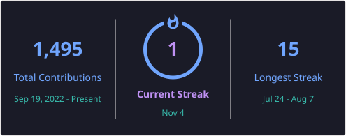

  

---

## 👩‍💻 About Me

I'm a **Senior Software Quality Engineer with 13+ years of IT experience**, transitioning into DevOps and Cloud Engineering through hands-on projects, practical implementations, and continuous learning.

My background in Software Quality Engineering has given me a strong foundation in automation, troubleshooting, problem-solving, Agile methodologies, and software delivery.

I'm now applying that experience to build and automate cloud infrastructure, develop CI/CD pipelines, containerize applications, implement DevSecOps practices, and explore scalable and reliable cloud-native solutions.

My engineering journey combines software quality principles with modern DevOps practices, focusing on automation, security, reliability, and continuous improvement.

🎯 **My goal:** Build practical, secure, automated, and reliable infrastructure and software delivery solutions.

💼 **Open to opportunities:** DevOps Engineer | Cloud Engineer | Platform Engineer | Site Reliability Engineer (SRE) | DevSecOps Engineer

---

## 🚀 Current Focus

- ☁️ AWS Cloud Engineering – 10 Weeks of AWS
- 🚀 CBC-BAN DevOps Internship
- 🏗️ Infrastructure as Code using Terraform
- ⚙️ CI/CD automation using GitHub Actions and Jenkins
- ☸️ Kubernetes, Helm, and container orchestration
- 🔐 DevSecOps and infrastructure security
- 📊 Monitoring, observability, and reliability engineering

---

# 🛠️ Tech Stack

## ☁️ Cloud Platforms

- Amazon Web Services (AWS)
- Microsoft Azure
- Amazon EC2, VPC, S3, IAM
- Azure Kubernetes Service (AKS)
- Azure Container Registry (ACR)
- Amazon Elastic Kubernetes Service (EKS)

## 🐳 Containers & Orchestration

- Docker
- Docker Compose
- Kubernetes
- Helm
- Amazon EKS
- Azure AKS
- Kind
- Minikube
- Kustomize

## 🏗️ Infrastructure as Code & Automation

- Terraform
- Ansible
- Bash Scripting
- Infrastructure as Code (IaC)
- AWS CLI
- Linux Administration

## ⚙️ CI/CD & Version Control

- GitHub Actions
- GitLab CI/CD
- Jenkins
- Git
- GitHub
- Argo CD
- CI/CD Pipeline Automation
- GitOps Fundamentals

## 🔐 DevSecOps & Security

- SonarCloud
- Trivy
- Docker Image Security
- Container Vulnerability Scanning
- Terraform Security Scanning
- Quality Gate Validation
- Secure CI/CD Practices

## 📊 Monitoring & Observability

- Prometheus
- Grafana
- Kubernetes Monitoring
- Azure AKS Monitoring
- Application Health Checks
- CloudWatch Fundamentals

## 💻 Operating Systems & Programming

- Linux
- Ubuntu
- Windows
- WSL
- Bash
- Python
- Java
- Maven
- MySQL
- Visual Studio Code

---

# 🚀 Featured Projects

My projects demonstrate practical implementations across cloud infrastructure, automation, CI/CD, containerization, Kubernetes, and DevSecOps.

## 1. ☁️ FlavorForge – Azure DevSecOps Capstone

An end-to-end Azure DevSecOps capstone project demonstrating application containerization, Kubernetes deployment, CI/CD automation, security scanning, and GitOps-based continuous delivery.

**Technologies**

`Azure` `Azure DevOps` `AKS` `ACR` `Docker` `Kubernetes` `Kustomize` `Argo CD` `GitHub` `SonarCloud` `Trivy`

**Key Highlights**

- Containerized frontend and backend applications using Docker.
- Built and published application images to Azure Container Registry.
- Provisioned Azure Kubernetes Service infrastructure.
- Implemented Kubernetes deployments and services.
- Organized Kubernetes configurations using Kustomize overlays for Dev, QA, and Prod.
- Integrated Argo CD for GitOps-based application delivery.
- Implemented Horizontal Pod Autoscaling (HPA).
- Integrated SonarCloud for code quality analysis.
- Used Trivy for container vulnerability scanning.
- Implemented CI/CD workflows using Azure DevOps and GitHub.
- Documented deployment architecture, security findings, and implementation evidence.

**Architecture and implementation:** Production-style DevSecOps workflow with actual AKS deployment and documented release-stage implementation.

🔗 **Repository:** [FlavorForge Azure DevSecOps Capstone](https://github.com/withmalathi/flavorforge-azure-devsecops-capstone)

---

## 2. ☁️ AWS EC2 + NGINX – Manual Infrastructure Deployment

A hands-on AWS project demonstrating the complete process of manually provisioning an EC2 instance, configuring networking, installing NGINX, and deploying a custom web page.

**Objective:** Understand the underlying AWS infrastructure and deployment workflow before automating it using Infrastructure as Code.

**Technologies**

`AWS` `EC2` `VPC` `Security Groups` `Linux` `NGINX` `AWS CLI`

**Key Highlights**

- Explored AWS VPC and subnet configuration.
- Configured EC2 instance networking.
- Created and configured security groups.
- Provisioned an EC2 instance using Amazon Linux 2023.
- Connected to the instance using SSH.
- Installed and configured NGINX.
- Deployed a custom HTML web page.
- Verified HTTP connectivity and NGINX service status.
- Captured implementation evidence and documented resource cleanup.

🔗 **Repository:** [AWS EC2 NGINX Manual Deployment](https://github.com/withmalathi/aws-ec2-nginx-deployment)

---

## 3. 🏗️ AWS EC2 + NGINX – Terraform Infrastructure Automation

An Infrastructure as Code project that automates the AWS EC2 and NGINX deployment using Terraform.

This project builds on the manual deployment use case by replacing repetitive infrastructure provisioning steps with reusable and declarative configuration.

**Objective:** Demonstrate how Terraform can automate infrastructure provisioning and improve consistency, repeatability, and maintainability.

**Technologies**

`AWS` `Terraform` `EC2` `VPC` `Security Groups` `Linux` `NGINX` `Infrastructure as Code`

**Key Highlights**

- Used Terraform to provision AWS infrastructure.
- Implemented AWS data sources to discover existing infrastructure.
- Automated security group creation.
- Provisioned EC2 instances using Terraform resources.
- Configured NGINX installation through EC2 user data.
- Implemented Terraform variables and outputs.
- Explored resource dependencies and execution order.
- Used Terraform initialization, planning, application, and destruction workflows.
- Documented infrastructure architecture and verification steps.
- Compared manual provisioning with Infrastructure as Code automation.

🔗 **Repository:** [Terraform AWS EC2 NGINX](https://github.com/withmalathi/terraform-aws-ec2-nginx)

---

## 4. 🐳 Docker Build Optimization & DevSecOps Case Study

A practical DevOps and DevSecOps case study focused on optimizing Docker image builds and improving software delivery through automation, security scanning, code quality analysis, and artifact management.

**Technologies**

`Docker` `Docker BuildKit` `Multi-stage Builds` `Docker Compose` `Jenkins` `GitHub Actions` `GitLab CI/CD` `SonarCloud` `Trivy` `Nexus Repository` `Docker Hub` `Apache Tomcat` `Maven` `Java`

**Key Highlights**

- Designed and implemented a DevSecOps CI/CD pipeline.
- Optimized Docker builds using multi-stage builds, BuildKit, and layer caching.
- Reduced Docker image size by **28.5% (856 MB → 612 MB)**.
- Automated build, test, code quality analysis, security scanning, and packaging.
- Implemented CI/CD workflows using Jenkins, GitHub Actions, and GitLab CI/CD.
- Integrated SonarCloud for code quality analysis and Quality Gate validation.
- Performed container vulnerability scanning using Trivy.
- Published build artifacts to Nexus Repository.
- Published versioned Docker images to Docker Hub.
- Automated deployment of a Java WAR application to Apache Tomcat.
- Documented optimization results, pipeline architecture, and implementation evidence.

🔗 **Repository:** [Docker Build Optimization Case Study](https://github.com/withmalathi/docker-build-optimization-case-study)

---

## 5. 🏦 AI BankApp – End-to-End DevOps Implementation

An end-to-end DevOps implementation for a Spring Boot banking application, demonstrating containerization, Kubernetes orchestration, infrastructure provisioning, and CI/CD automation.

**Technologies**

`AWS` `Amazon EKS` `Docker` `Kubernetes` `Helm` `Terraform` `GitHub Actions` `Spring Boot`

**Key Highlights**

- Containerized the application using Docker.
- Provisioned Amazon EKS infrastructure using Terraform.
- Created Helm charts for Kubernetes deployments.
- Automated build and deployment workflows.
- Configured Horizontal Pod Autoscaling.
- Applied Infrastructure as Code practices.
- Worked with a production-style multi-tier application architecture.

🔗 **Repository:** [AI BankApp DevOps](https://github.com/withmalathi/AI-BankApp-DevOps)

---

## 6. ⚙️ GitHub Actions Capstone

A hands-on CI/CD project demonstrating automated software delivery using GitHub Actions and Docker.

**Technologies**

`GitHub Actions` `Docker` `Docker Hub`

**Key Highlights**

- Automated application build workflows.
- Built Docker images using GitHub Actions.
- Published Docker images to Docker Hub.
- Implemented Continuous Integration workflows.
- Improved build and deployment automation.

🔗 **Repository:** [GitHub Actions Capstone](https://github.com/withmalathi/github-actions-capstone)

---

## 7. ☸️ GitHub Actions Kubernetes Masterclass

A DevOps project demonstrating Kubernetes application deployments automated through GitHub Actions.

**Technologies**

`Kubernetes` `Docker` `GitHub Actions`

**Key Highlights**

- Automated Kubernetes deployment workflows.
- Integrated Docker image builds.
- Implemented GitHub Actions CI/CD pipelines.
- Managed Kubernetes manifests.
- Improved deployment consistency through automation.

🔗 **Repository:** [GitHub Actions Kubernetes Masterclass](https://github.com/withmalathi/github-actions-kubernetes-masterclass)

---

## 8. 🚀 CBC-BAN DevOps Internship

A practical DevOps internship focused on implementing real-world assignments involving Linux, cloud infrastructure, containerization, Kubernetes, automation, and CI/CD.

**Technologies**

`Linux` `Shell Scripting` `Git` `Docker` `Kubernetes` `Azure` `Terraform` `CI/CD`

**Key Highlights**

- Worked on hands-on DevOps engineering assignments.
- Practiced Linux administration and shell scripting.
- Implemented Docker containerization workflows.
- Worked with Kubernetes deployments.
- Explored Azure cloud infrastructure and AKS.
- Built CI/CD workflows.
- Applied Infrastructure as Code concepts.
- Developed practical project documentation and implementation evidence.

🔗 **Repository:** [CBC-BAN DevOps Internship](https://github.com/withmalathi/CBC-Ban-DevOps-Internship)

---

## 9. ☁️ 10 Weeks of AWS

A structured AWS learning journey focused on understanding cloud fundamentals, core AWS services, infrastructure, networking, security, and practical cloud implementations.

**Topics Covered**

- AWS Global Infrastructure
- Identity and Access Management (IAM)
- Amazon EC2
- Amazon S3
- Amazon VPC
- AWS Networking Fundamentals
- Security Best Practices
- Billing and Cost Management

🔗 **Repository:** [10 Weeks of AWS](https://github.com/withmalathi/10WeeksOfAWS)

---

## 10. 📘 90 Days of DevOps

Successfully completed the 90 Days of DevOps challenge, gaining practical exposure to tools and workflows across the DevOps lifecycle.

**Technologies**

`Linux` `Bash` `Git` `GitHub` `Docker` `Kubernetes` `Helm` `Kind` `Minikube` `Terraform` `Ansible` `Jenkins` `GitHub Actions` `AWS` `Prometheus` `Grafana`

**Key Highlights**

- Completed the 90 Days of DevOps hands-on challenge.
- Practiced Linux administration and Bash scripting.
- Worked with Git and GitHub.
- Containerized applications using Docker.
- Deployed applications on Kubernetes.
- Explored Helm, Kind, and Minikube.
- Provisioned infrastructure using Terraform and Ansible.
- Built CI/CD pipelines using Jenkins and GitHub Actions.
- Gained hands-on exposure to AWS.
- Explored monitoring using Prometheus and Grafana.

🔗 **Repository:** [90 Days of DevOps – TrainWithShubham](https://github.com/withmalathi/90DaysOfDevOps_TrainWithShubham)

---

# 🔬 Advanced Engineering Use Cases – Roadmap

Beyond individual projects, I am progressively exploring how to evolve basic deployments into more automated, secure, scalable, and reliable cloud solutions.

These are planned enhancements and future projects, not claims of completed implementations.

## 1. 🔐 AWS Terraform DevSecOps Pipeline

**Planned Focus**

- GitHub Actions-based Terraform CI/CD.
- AWS authentication using GitHub OIDC.
- Terraform formatting and validation.
- Automated Terraform plan on pull requests.
- Security scanning using Checkov and Trivy.
- TFLint integration.
- Approval-based infrastructure deployment.
- Remote Terraform state management using Amazon S3.

## 2. 📈 AWS High Availability Web Platform

**Planned Focus**

- Application Load Balancer.
- EC2 Auto Scaling Groups.
- Multi-AZ architecture.
- Public and private subnet architecture.
- HTTPS using AWS Certificate Manager.
- CloudWatch monitoring and alarms.
- Centralized application logging.
- Infrastructure provisioning using Terraform.

## 3. 📊 AWS Monitoring & Reliability Engineering

**Planned Focus**

- CloudWatch metrics and dashboards.
- EC2 instance health monitoring.
- NGINX access and error log monitoring.
- Application health checks.
- SNS-based alert notifications.
- Availability and recovery testing.
- Basic disaster recovery planning.

The goal is to progressively develop these use cases into independently documented, hands-on engineering projects.

---

# 🧠 Engineering Practices & Concepts

- Infrastructure as Code (IaC)
- Continuous Integration and Continuous Delivery
- GitOps
- Containerization and Orchestration
- DevSecOps and Shift-Left Security
- Infrastructure Automation
- Cloud Networking
- Infrastructure Monitoring
- Observability Fundamentals
- High Availability
- Scalability and Reliability
- Disaster Recovery
- Cloud Cost Optimization
- Version Control and Collaboration
- Troubleshooting and Root Cause Analysis

---

# 🏆 Achievements & Certifications

- 🎯 Successfully completed the 90 Days of DevOps challenge.
- 🎓 Certified DevOps Engineer Associate – TrainWithShubham.
- 📜 Professional Scrum Master I (PSM I).
- 📜 ISTQB Certified Tester Foundation Level (CTFL).
- 📜 ISTQB Certified Tester Foundation Level – Agile Tester.
- 🏅 Community Builder of the Week.
- 🏅 Automation Hero.
- 🏆 Secured first position in the Agentic AI in 7 Days cohort.

---

# 📊 GitHub Statistics

---

# 📊 GitHub Metrics

---

# 📚 Learning Journey

I'm committed to continuous learning and regularly work on hands-on projects to strengthen my Cloud and DevOps engineering skills.

### ✅ Completed

- 90 Days of DevOps Challenge.
- DevOps Engineer Associate Training.
- AWS EC2 + NGINX Manual Deployment.
- Terraform AWS EC2 + NGINX Automation.
- Docker Build Optimization Case Study.
- FlavorForge Azure DevSecOps Capstone.

### 🚀 Continuing to Explore

- AWS Cloud Engineering.
- Terraform Advanced Concepts.
- Kubernetes and Cloud-Native Technologies.
- CI/CD and GitOps.
- DevSecOps Automation.
- Platform Engineering.
- Monitoring and Reliability Engineering.

---

# 🤝 Open to Opportunities

I'm actively looking for opportunities where I can combine my Software Quality Engineering background with practical DevOps and Cloud Engineering skills.

### Interested Roles

- 🚀 DevOps Engineer
- ☁️ Cloud Engineer
- ⚙️ Platform Engineer
- 📈 Site Reliability Engineer (SRE)
- 🔐 DevSecOps Engineer

### What I Bring

- 13+ years of Software Quality Engineering experience.
- Strong foundation in software testing and automation.
- Understanding of SDLC and Agile methodologies.
- Hands-on experience with cloud and DevOps tools.
- Practical experience building CI/CD pipelines.
- Exposure to containerization and Kubernetes.
- Infrastructure as Code and cloud automation experience.
- A quality-driven approach to reliability, security, and continuous improvement.

I'm always excited to collaborate on open-source projects, learn from the DevOps community, and contribute to building scalable and reliable software delivery solutions.

---

# 🌍 Let's Connect

---

# 💡 My Engineering Philosophy

> **"Quality taught me how to build reliable software. DevOps is teaching me how to deliver it faster, automate it smarter, secure it better, and scale it with confidence."**

---

## ⭐ Thank You for Visiting!

Thanks for taking the time to explore my GitHub profile.

If you find my projects helpful, feel free to ⭐ star the repositories, connect with me, or collaborate on open-source projects.

I'm always eager to learn, build, share knowledge, and contribute to the DevOps community.

### 🚀 Happy Learning & Happy Automating!

